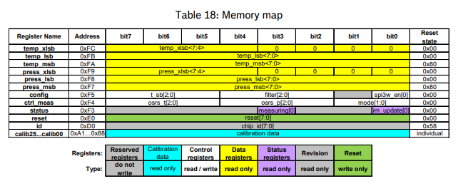

<h2>THEORY BEHIND SENSOR</h2>
<h4>memory map</h4>

<h4>initialization life cycle</h4>

  
### Initialization
- Reset sensor
- Wait for reset to complete
- Read calibration data
- Configure sensor

### Loop
- Check measurement status
- Read raw data
- Reconstruct raw values
- Perform temperature compensation
- Perform pressure compensation
- Add a 500 ms delay before the next measurement

